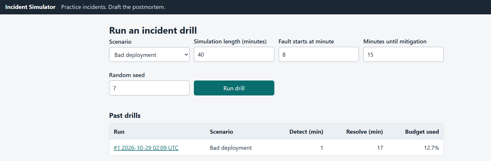

# Incident Simulator and Postmortem Drafter

Run a simulated production incident (bad deploy, DB pool exhaustion, dependency timeout, memory leak,
expired certificate), see detection and recovery metrics against an SLO, add your own notes, and get a
blameless postmortem draft. An optional AI step polishes the draft using only the facts provided.

## Run locally
    python -m venv .venv && source .venv/bin/activate
    pip install -r requirements-dev.txt
    uvicorn app.main:app --reload     # http://127.0.0.1:8000  (login admin / admin)

## Test
    python -m pytest -q
    ruff check .

## Deploy (Render + Neon)
Set ENV=production, DATABASE_URL, APP_USERNAME and APP_PASSWORD (12+ characters). Optional: ANTHROPIC_API_KEY
and LLM_MODEL. See render.yaml. Health check: /health.

## Screenshot

Live demo is behind a login.
